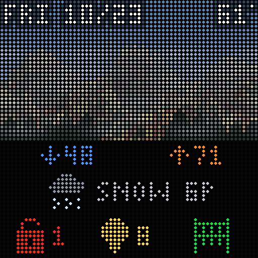
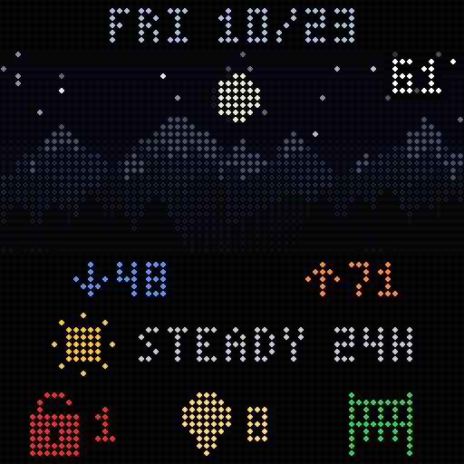
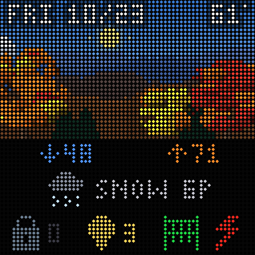

# Home Status Matrix

A 64x64 RGB LED matrix on a Raspberry Pi Zero 2 W (Adafruit RGB Matrix Bonnet) that shows, at a glance, the date, an
animated weather scene with the temperature, today's low and high, the next change in the weather, and Home Assistant
status: unlocked doors, lights on, gates, and optionally the electricity rate tier.

<p>
  
  
  
</p>

It is a single Rust program (`matrix-display`) that runs as a systemd service. The weather comes from
[Open-Meteo](https://open-meteo.com) (no key); Home Assistant is read through a read-only token. The panel is driven by
[`rpi-led-panel`](https://github.com/EmbersArc/rpi_led_panel), a pure Rust port of hzeller's driver (we use
[a fork](https://github.com/pshanesmith/rpi_led_panel) with a 64-bit fix). Everything except the final push to the
panel also runs on a laptop through an emulator, so most development needs no hardware.

More: [DESIGN.md](DESIGN.md) (how and why), [docs/operations.md](docs/operations.md) (running it),
[docs/hardware.md](docs/hardware.md) (wiring and panel checks).

## Install on the Pi

Prerequisites: Raspberry Pi OS Lite, 64-bit (Debian 13), with the panel wired as in
[docs/hardware.md](docs/hardware.md). The installer needs no git and no compiler: GitHub Actions builds the program
and the installer downloads it as one checksummed archive.

```bash
curl -fsSL https://github.com/pshanesmith/LEDMatrixGadget/releases/latest/download/install.sh | sudo bash
```

That installs into `/opt/matrix`, creates `/etc/matrix`, writes the systemd units and starts the service. Run the same
command again to update. Options go after `-s --`, for example `... | sudo bash -s -- --version v0.2.3 --yes`:

| Option | Meaning |
|---|---|
| `--version TAG` | install that release instead of the latest |
| `--from-source [--ref NAME]` | clone the repository and compile on the Pi instead (slow; about 1 GB of RAM including swap; installs `git`, `gcc`, `cargo` and `rustc` if missing) |
| `--no-start`, `--no-drop`, `--yes` | do not start the service; keep running as root; do not ask questions |
| `--dry-run` | download, verify and unpack, and show what would be installed |

The script runs as root, so you may prefer to read it first: `curl -fsSLO <same url>`, `less install.sh`,
`sudo bash install.sh`. A private repository cannot use the plain download (see
[docs/operations.md](docs/operations.md)).

**Before the first install** (a Pi that has not been set up for this panel yet): the panel needs the on-board sound
driver off and one CPU core reserved. The installer will stop if the sound driver is still loaded. Run `sudo /opt/matrix/setup/02-matrix-setup.sh --apply` (and
`01-pi-setup.sh --apply` if you also want the slimmed-down, self-updating Pi described in DESIGN.md), reboot, then run
the installer again.

### Configure

```bash
sudo /opt/matrix/bin/matrix-geocode 10001 --config /etc/matrix/config.toml   # your ZIP: writes [location]
sudo nano /etc/matrix/secrets.env                                           # MATRIX_HA_TOKEN=... (Home Assistant long-lived token)
sudo /opt/matrix/bin/matrix-ha-discover --toml                              # lists locks, lights, gates; prints a config snippet (reads the token as root)
sudo nano /etc/matrix/config.toml                                           # gates, excluded lights, power_tier_entity, brightness...
sudo systemctl reload matrix-display                                        # re-read the config without restarting
```

Settings are documented in [`config/config.example.toml`](config/config.example.toml). The token lives only in
`secrets.env` (mode 600) or the environment, never in `config.toml`; `MATRIX_HA_URL` overrides the Home Assistant
address (default `http://homeassistant:8123`).

### Check and operate

```bash
sudo /opt/matrix/tools/test-matrix.sh        # guided panel test (service stopped): rows, colours, flicker
journalctl -u matrix-display -f              # live log, with a performance line every minute
/opt/matrix/tools/soak-report.sh             # health summary: restarts, memory, throttling
cat /opt/matrix/VERSION                      # the installed release
sudo /opt/matrix/setup/03-install-service.sh --uninstall
```

Flicker, wrong colours and other panel problems are covered in [docs/operations.md](docs/operations.md) and
[docs/hardware.md](docs/hardware.md). The Pi has about 460 MB of RAM; keep large programs (including Claude Code) off it.

## Develop

You need Rust 1.85 or newer. Everything below is for the machine you develop on (a Mac or Linux); the Pi needs none
of it when you install a release.

| Needed for | Tool | Install (macOS) |
|---|---|---|
| Building, tests, previews, the emulator | Rust 1.85+ (`cargo`, `rustc`, `clippy`) | `brew install rustup && rustup default stable` (or `brew install rust`) |
| The shell-script tests and `tools/package-release.sh` | `bash`, `tar`, `curl`, and `sha256sum` or `shasum` | already on macOS and Linux |
| Cross-building for the Pi (`tools/cross-build.sh`) | `zig`, `cargo-zigbuild`, and the Rust target `aarch64-unknown-linux-gnu` (add `aarch64-unknown-linux-musl` for a static build) | `brew install zig cargo-zigbuild`, then `rustup target add aarch64-unknown-linux-gnu` |
| Publishing a release by hand | GitHub CLI `gh`, logged in | `brew install gh && gh auth login` |
| The Pi setup-script tests (`apt-config`, `systemd-analyze`) | Linux only; skipped elsewhere | none |

No Python, C++ toolchain, `make` or image library is needed. The first build downloads the crates in `Cargo.lock`
(and the driver fork from GitHub), so it needs network access. If `cargo` came from `rustup` but is not on your `PATH`,
it is in `~/.rustup/toolchains/stable-*/bin`.

```bash
cargo test                                                                       # about 180 tests, no panel or network needed
cargo run --bin matrix-preview -- --sample rain_then_snow --debug-layout --out preview.png
cargo run -- --emulate --offline --sample thunder --seconds 4 --out demo.gif     # animated preview
cargo run -- --emulate --once --out frame.png                                    # one frame from live data
```

Samples: `clear_day clear_night partly_cloudy overcast fog rain_then_snow snow thunder`.
`cargo run --bin matrix-preview -- --all` writes every sample and UI variant to `docs/previews/`.
Copy `config/config.example.toml` to `config/config.toml` and `config/secrets.env.example` to `secrets.env` (both
gitignored) to run against live data, and enable the commit guard with `git config core.hooksPath .githooks`.

The default build has no panel driver. `--features hardware` adds it; the driver is Linux-only, so that build is made
for the Pi with `tools/cross-build.sh`, not on a Mac.

### Layout

```
src/            the library: state, layout, config, gfx (framebuffer), compositor, runner (the live loop),
                scene/ (weather scene), ui/ (font, icons, widgets), data/ (weather, Home Assistant, geocoding),
                display/ (emulator, panel backend, test patterns)
src/main.rs     matrix-display, the service
src/bin/        matrix-preview, matrix-geocode, matrix-ha-discover, matrix-set-config, matrix-hello
setup/ tools/   Pi setup scripts, cross-build and release packaging, hardware test, health check
tests/          scene, widgets, programs, scripts and release tests; golden images in tests/golden/
```

The scene and widgets match the original Python version pixel for pixel; `tests/golden/` holds images that version
made. See [DESIGN.md](DESIGN.md) for the details.

### Make a release

Bump `version` in `Cargo.toml`, commit, then `git tag vX.Y.Z && git push origin vX.Y.Z`. The release workflow
(`.github/workflows/release.yml`) runs the tests, cross-builds for the Pi, packs and publishes
`matrix-display-aarch64.tar.gz`, its checksum and `install.sh`; the tag must equal the Cargo version. To do it by hand:
`./tools/cross-build.sh && ./tools/package-release.sh`, then
`gh release create vX.Y.Z dist/matrix-display-aarch64.tar.gz dist/matrix-display-aarch64.tar.gz.sha256 dist/install.sh`.

## Licence

GPL-3.0-only: see [LICENSE](LICENSE). It also matches the panel driver this links, which is GPL-3.0.
